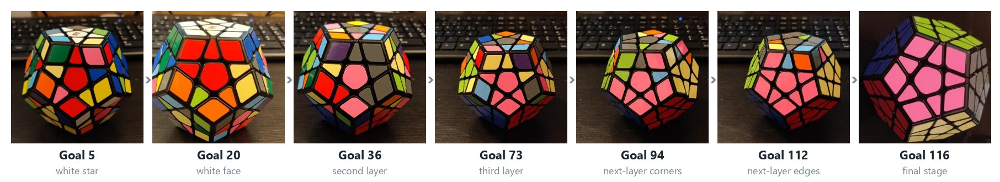
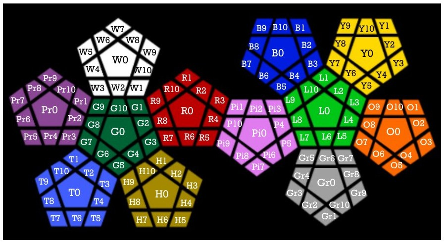
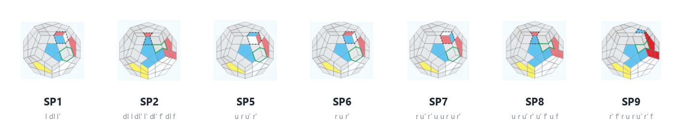

# Megaminx Solver in Prolog

A Prolog program that solves the **Megaminx**, the 12-faced dodecahedral cousin of the Rubik's cube.
It turns the step-by-step human solving method into **116 sub-goals**. For each sub-goal, a **breadth-first search** runs over a restricted move set that includes multi-move macro operators ("special moves").
The repository also contains a sticker-matching **heuristic** for informed search (RBFS).

<p align="center">
  
</p>

<sub>The physical Megaminx at selected sub-goals, from the first white star to the final stage. Each sub-goal is a partially specified cube state in <code>megaminx_goals.pl</code>.</sub>

---

## How it works

**1. Cube model.** The cube state is a single Prolog term, `megaminx/132`: 12 faces × 11 stickers (1 centre, 5 corners, 5 edges).
Each face turn (`u, l, f, r, br, bl, dl, dr, bdr, bdl, d`) and each whole-cube reorientation (`r_v`, `r_ud`) is a fact that maps one state to the next.
Because the relation is pure, the same fact also gives the counter-clockwise turn when Prolog runs it backwards.

<p align="center">
  
</p>

**2. Sub-goals.** Each of the 116 goals is a cube pattern with unbound variables for the stickers that don't matter yet.
Unification therefore does the goal test for free: a state satisfies a goal exactly when it unifies with the pattern.

**3. Staged search.** `stage/3` walks through the goals. For every stage, `rotate/4` searches for the shortest move sequence that reaches the next goal:

```prolog
rotate(Stage, Moves, State, Goal) :-
    rotate(Stage, PriorMoves, State, Next),     % grow the sequence one move at a time
    get_move(Stage, NextMove, Next, Goal),      % try a candidate allowed in this stage
    not(conflict(PriorMoves, NextMove)),        % never undo the previous move
    append([NextMove], PriorMoves, Moves).
```

`cand/2` limits the branching factor for each stage. Some stages may only use one macro (for example `sp2`), and others may use all basic turns.

**4. Macro operators.** Human algorithms are encoded as single "moves", so the search finds them at depth 1 instead of depth 6–12:

<p align="center">
  
</p>

**5. Heuristic (RBFS folder).** `heuristic/3` counts how many of the 132 stickers already match the target state. The value ranges from 12 (only the centres match) to 132 (solved). It is meant as the evaluation function for recursive best-first search.

## Results

- A scramble of 55 random moves is solved in about **23 minutes** with SWI-Prolog. The console prints every stage, its moves and the cube state.
- The final move list is checked by replaying it on the scrambled cube.

## Running it

Requires [SWI-Prolog](https://www.swi-prolog.org/).

```bash
# staged human-method solver (runs the scramble in mytest.pl)
cd "Megaminx Human Algorithm"
swipl megaminx_algorithm.pl megaminx_goals.pl megaminx_rotations.pl mytest.pl
?- testcase.

# heuristic value of a scrambled cube (runs automatically)
cd "Megaminx RBFS"
swipl heuristic.pl megaminx_rotations.pl heuristic_test.pl
```

## Repository layout

| Path | Contents |
|---|---|
| `Megaminx Human Algorithm/megaminx_rotations.pl` | Face turns, cube reorientations and the special moves SP1–SP16 |
| `Megaminx Human Algorithm/megaminx_goals.pl` | The 116 sub-goal patterns |
| `Megaminx Human Algorithm/megaminx_algorithm.pl` | Stage control, per-stage move sets, search and pretty-printer |
| `Megaminx Human Algorithm/mytest.pl` | Scramble, solve, verify and time a test case |
| `Megaminx RBFS/heuristic.pl` | Sticker-matching heuristic |
| `Documentation/` | Slide decks with a photo of every sub-goal and the special-move diagrams |

## Team & my contribution

University group project, winter term 2020/21 (MMR 2020, group 3: Abdank, Baghdadi, Scheucher, Schillhammer, Wiesmüller).

**My part (Abdulhamid Baghdadi):** the Megaminx state model and most of the rotation definitions, the search core (staged BFS, move conflict pruning, special-move mechanism), sub-goals 1–18 and 113–116 (teammates encoded stages 19–112), the heuristic function, the test harness with timing, and the goal documentation slides.
